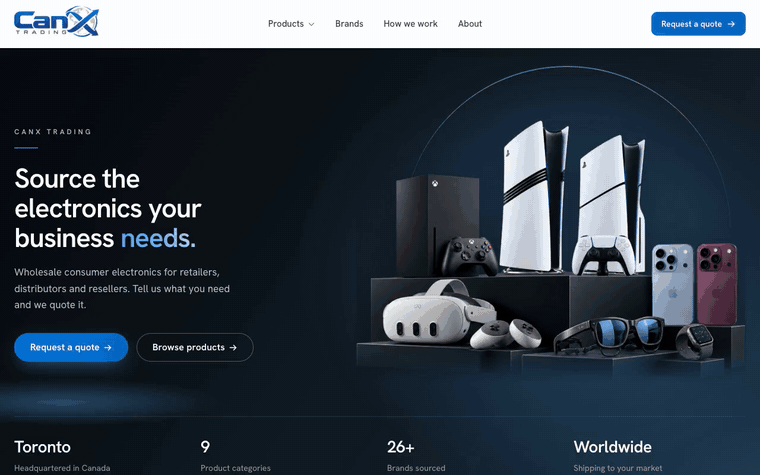
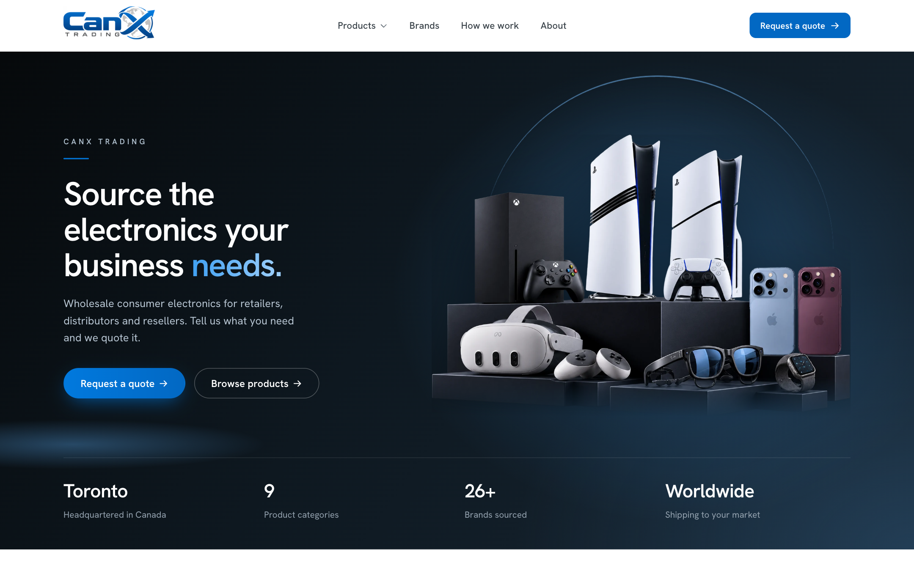
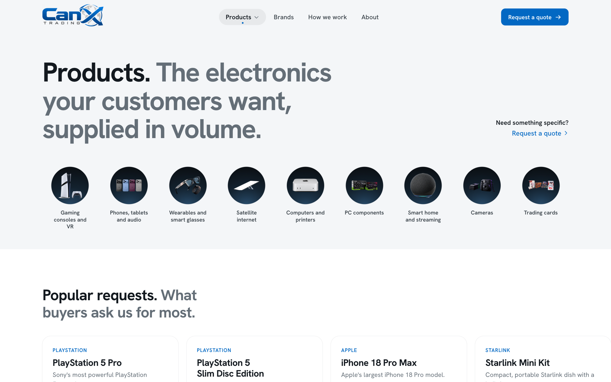
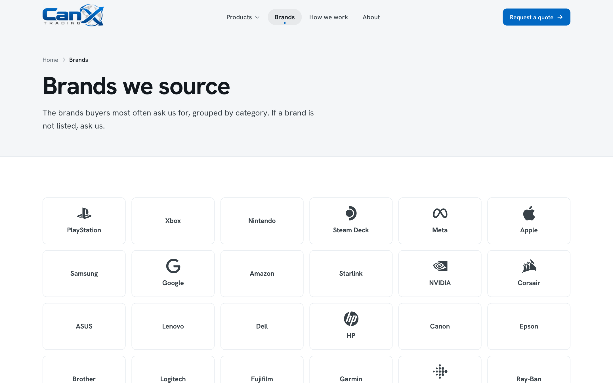
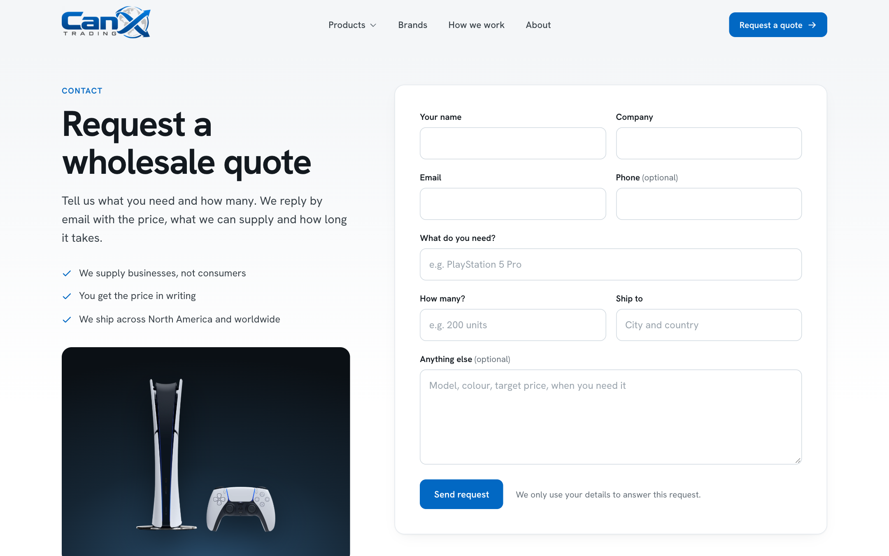
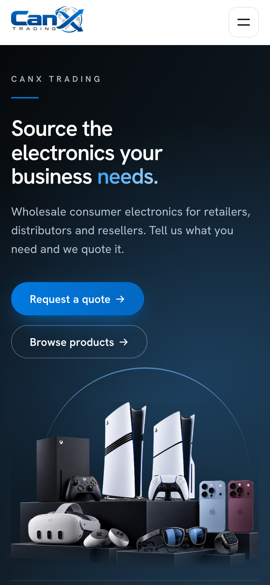

# CanX Trading - Canadian Electronics Wholesale Website

A marketing website I built for CanX Trading, a Canadian electronics trading company, with a quote request workflow built for wholesale buyers.

<a href="media/demo.mp4">Watch the full-quality video</a>

## What it does

- A clean, photo-led multi-page site built around a product catalogue, with category and individual product pages
- A request-for-quote form, protected against spam and abuse (origin checks, rate limiting, and a honeypot field), with quotes emailed straight to the sales team
- Strong security headers and a strict content security policy
- Optimised images and fast page loads, with no animation libraries weighing the site down

## Screenshots

**Home page**

**Products**

**Brands**

**Contact**

**Mobile layout**

## Tech used

Next.js, React and TypeScript, with plain CSS.

---

This repository is a public overview only — the source code is kept private.
